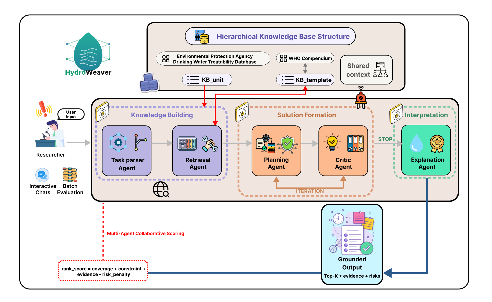
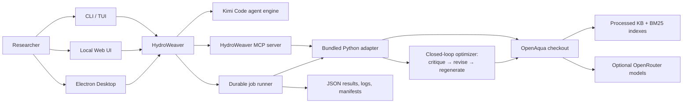

<p align="center">
  
</p>

<h1 align="center">HydroWeaver</h1>

<p align="center"><strong>From Plausible to Feasible Water Treatment Train Designs through Agentic Closed-Loop Optimization</strong></p>

<p align="center"><strong>Beta candidate · v0.2.0-beta.1</strong></p>

<p align="center"><strong>English</strong> | <a href="./README.zh-CN.md">简体中文</a></p>

<p align="center">
  A local workbench that turns early-stage water-treatment questions into constraint-feasible treatment trains. It wraps the open-source <a href="https://github.com/zhaorui-bi/OpenAqua">OpenAqua</a> five-agent research pipeline in a closed critique–revision–regeneration loop and ships CLI, terminal UI, local Web UI, Electron desktop, MCP tools, durable jobs, and engineering provenance.
</p>

<p align="center">
  <a href="https://github.com/zhaorui-bi/HydroWeaver/actions/workflows/ci.yml"></a>
  <a href="https://github.com/zhaorui-bi/HydroWeaver/releases"></a>
  <a href="./LICENSE"></a>
  
  
</p>

<p align="center">
  
</p>

---

## What is HydroWeaver?

A one-shot treatment-train recommendation is only **plausible**: it reads well, cites
evidence, and still violates the site constraints a plant must live with. HydroWeaver
exists to close that gap. It keeps OpenAqua's typed scientific pipeline —

```text
Task Parser → Retrieval → Planning → Critic → Explanation
```

— and wraps it in an **agentic closed loop** that iterates until the trains it hands
you are **feasible** under the declared engineering constraints:

```text
        ┌──────────────────────────────────────────────────────────┐
        │                                                          │
        ▼                                                          │
  generate candidate trains ──► apply the constraint critic ──► all chains pass?
  (planner, or caller-supplied)   (taxonomy, disinfection,          │
                                   brine, energy rules)             │
        ▲                                                          │
        │                                                          │
  regenerate with a            ◄──── stalled? (no critic progress)  │
  structured revision                                            feasible ──► stop
  directive through the planner      within the round budget
```

Each round is recorded: the candidates before and after the critic's auto-revision,
the machine-readable constraint report, the unresolved violations, and the revision
directive sent back to the planner. The loop stops when every chain passes its
constraint checks, when the critic and the planner stop making progress, or when the
declared round budget is exhausted — and the record always says which of the three
happened.

HydroWeaver embeds the MIT-licensed
[Kimi Code](https://github.com/MoonshotAI/kimi-code) agent engine, exposes the
pipeline and the loop through an MCP stdio server, and provides one product across
terminal, browser, and desktop interfaces. OpenAqua itself remains an external,
MIT-licensed Python project; this repository vendors no Python science code and no
knowledge data.

### Highlights

| Capability | What it provides |
| --- | --- |
| **Closed-loop optimization** | `hydroweaver_optimize_trains` runs the critique → revision → regeneration loop with a bounded round budget, per-round constraint reports, a structured planner revision directive, and an explicit convergence status (`feasible`, `stalled`, `budget_exhausted`). |
| **Five-agent scientific pipeline** | Query normalization, hybrid evidence retrieval, taxonomy-constrained planning, rule-based critique, and evidence-bound explanations through the OpenAqua backend. |
| **Focused MCP surface** | 25 tools for gated research tasks, runtime readiness, scientific case assessment, closed-loop optimization, recommendation auditing, taxonomy, recommendation, retrieval, constraint checking, indexing, knowledge staging, WContBench evaluation, and durable job control. |
| **Persistent research tasks** | Frozen case revisions, declared scope, structured information needs, bounded job and round budgets, and recoverable readiness → assessment → retrieval → recommendation → optimization → audit → handoff stages. |
| **Three user interfaces** | Full terminal UI, lightweight CLI/REPL, local browser UI, and an Electron desktop shell backed by the same harness. |
| **Durable engineering jobs** | Long operations survive session closure and expose lifecycle state, bounded logs, output metadata, input hashes, payload hashes, and request fingerprints. |
| **Two model layers** | API-provider setup for the conversational agent, plus optional `OPENROUTER_API_KEY` support for OpenAqua's parser/planner/explainer agents. |
| **Local-first security** | Private configuration, atomic writes, strict path handling, no shell command interpolation, bounded process output, and loopback-only authenticated Web serving by default. |

> [!IMPORTANT]
> HydroWeaver outputs are early-stage engineering decision support. A *feasible*
> result means every chain passed the machine-readable constraint checks — not that
> the train is sized, costed, or field-validated. Nothing here is final process
> design, regulatory approval, a performance guarantee, or a substitute for expert
> review, treatability testing, pilot testing, and site-specific engineering.

## Interface overview

These screenshots show the local Web UI; the desktop app uses the same interface.


**Workbench.** The sidebar organizes workspaces and sessions, while the central
conversation area supports research tasks. Use the composer to describe a case
and the add button to attach supporting files. **Always Ask** shows the approval
mode, and **Set up model** opens model configuration. The arsenic-contaminated
groundwater question shown here is an **unsent example input**.


**Model setup.** Open **Settings → Model Providers → Add provider → Custom** to
choose the API protocol, service address (**Base URL**), and available models.
The API key field is empty and the form shows placeholders. These settings
control the HydroWeaver conversational model; OpenAqua's optional backend models
are configured separately.

## Architecture



OpenAqua source code and Hugging Face data are **not vendored** into this
repository. The bundled adapter provides a stable command contract over an
external OpenAqua checkout, including the `optimize` command that drives the
closed loop inside a single bounded backend process.

## Requirements

- Node.js **24.15.0 or newer**
- npm **12**
- Python **3.10 or newer** for the OpenAqua backend
- A local OpenAqua checkout for research operations
- Processed OpenAqua data and built indexes for taxonomy/retrieval/design
- macOS, Linux, or Windows

## Quick start

### 1. Install HydroWeaver

```bash
git clone https://github.com/zhaorui-bi/HydroWeaver.git
cd HydroWeaver

npm ci
npm run setup
```

`npm run setup` installs the pinned engine workspace, builds HydroWeaver, and
synchronizes the branded Web UI.

### 2. Install OpenAqua

```bash
git clone https://github.com/zhaorui-bi/OpenAqua.git
cd OpenAqua
git checkout 0e3990817946f1786828fabbfa9ba4bc06af96e8
cd water_treatment_agent

python3 -m venv .venv
source .venv/bin/activate                 # Windows: .venv\Scripts\activate
python -m pip install -r requirements.txt
```

Download the processed knowledge base and WContBench from
[Hugging Face](https://huggingface.co/datasets/zhaorui-bi/OpenAqua):

```bash
python -m pip install -U huggingface_hub
hf download zhaorui-bi/OpenAqua data.zip WContBench/ \
  --repo-type dataset \
  --revision cc2d3c620e8ada7c62fa922cf3a827d8b42889e3 \
  --local-dir ../hf_openaqua

unzip ../hf_openaqua/data.zip -d .
```

The archive already contains its top-level `data/` directory; extract it into
`water_treatment_agent`, not into an existing `data/` directory. The Git and
Hugging Face revisions above are the `0.1.0-beta.1` validation baseline,
retained for `0.2.0-beta.1`; record
and revalidate both if you intentionally update them. Keep
`../hf_openaqua/WContBench/` for evaluation. `RawData.zip` is optional.

### 3. Configure both model layers

The HydroWeaver agent needs a chat model provider. OpenAqua itself can optionally
use OpenRouter; without it, OpenAqua uses its rule/template fallbacks.

```bash
# Optional OpenAqua backend LLMs
export OPENROUTER_API_KEY="..."
export HYDROWEAVER_OPENROUTER_MODEL="anthropic/claude-3.5-sonnet"  # optional shared override
# Granular alternatives: HYDROWEAVER_DEFAULT_MODEL,
# HYDROWEAVER_PLANNER_MODEL, and HYDROWEAVER_EXPLANATION_MODEL.

# HydroWeaver agent model (example: DeepSeek)
export DEEPSEEK_API_KEY="..."
cd /path/to/HydroWeaver
./bin/hydroweaver onboard \
  --provider deepseek \
  --api-key-env DEEPSEEK_API_KEY \
  --hydroweaver-repo /path/to/OpenAqua
```

Interactive setup is also available:

```bash
./bin/hydroweaver onboard
```

### 4. Build indexes and verify

```bash
./bin/hydroweaver doctor --probe
./bin/hydroweaver tools
```

Then ask the agent to run `hydroweaver_build_indexes`, or run the adapter directly:

```bash
HYDROWEAVER_REPO=/path/to/OpenAqua \
  ./bin/hydroweaver run "Check OpenAqua status and build the knowledge indexes if they are missing."
```

### 5. Start an interface

```bash
./bin/hydroweaver                                       # full TUI
./bin/hydroweaver run "Recommend a train for arsenic-bearing groundwater"
./bin/hydroweaver chat                                  # lightweight REPL
./bin/hydroweaver web                                   # local browser UI
npm start                                               # Electron desktop
```

On Windows, use `npm run cli -- <command>` instead of `./bin/hydroweaver`.

## Close the loop: from plausible to feasible

The closed-loop optimizer is the difference between a shortlist that reads well and
a shortlist that survives the site's own rules. Run it directly:

```bash
./bin/hydroweaver optimize --input case.json --top-k 3 --max-rounds 4 --wait
```

or ask the agent to call `hydroweaver_optimize_trains`. The record it returns shows
exactly how the trains evolved:

```json
{
  "kind": "hydroweaver.closed-loop-optimization",
  "optimization": {
    "status": "feasible",
    "rounds_used": 2,
    "max_rounds": 4,
    "initial_source": "caller",
    "planner_regeneration_used": false,
    "feasible_chains": 1,
    "unresolved": []
  },
  "rounds": [
    {
      "round": 1,
      "source": "caller",
      "candidates_before": [["Membrane Separation"]],
      "constraint_report": { "chain_reports": [{ "chain_id": "chain-1", "overall_status": "FAIL" }] },
      "metrics": { "feasible": false, "unresolved_count": 1 }
    },
    {
      "round": 2,
      "source": "critic-revision",
      "revision_directive": null,
      "candidates_after_revision": { "candidates": [{ "chain_id": "chain-1", "chain": ["Adsorption", "Disinfection"] }] },
      "constraint_report": { "chain_reports": [{ "chain_id": "chain-1", "overall_status": "PASS" }] },
      "metrics": { "feasible": true, "unresolved_count": 0 }
    }
  ],
  "final_trains": [
    { "chain_id": "chain-1", "chain": ["Adsorption", "Disinfection"], "constraint_report": { "overall_status": "PASS" } }
  ]
}
```

Loop semantics:

- **Initial candidates** come from the pipeline planner (`--top-k` trains) or from
  caller-supplied `candidateChains`.
- **Each round** applies the constraint critic and records per-chain status,
  violations, and the critic's in-place auto-revision.
- **Stall fallback**: when a round's critic makes no progress, the loop regenerates
  candidates through the planner with a structured revision directive naming the
  failing chains and their violations.
- **Stopping** is explicit: `feasible` (every chain passed), `stalled` (critic and
  planner both stopped making progress), or `budget_exhausted` (round budget spent).
- A chain with **no machine-readable constraint report** is never claimed
  feasible.

## Example query

A structured prompt gives the pipeline the clearest contract:

```text
Use HydroWeaver to assess groundwater with arsenic at 150 µg/L.
Target ≤10 µg/L under WHO guidance. Budget is low, operator skill is low,
brine disposal is unavailable, and the water is intended for drinking.
Normalize the query, retrieve evidence, recommend three treatment trains,
optimize them until every chain passes the constraint checks, show the
revision rounds and uncertainty, and save the JSON result.
```

The agent should preserve the units, inspect taxonomy readiness, launch a durable
recommendation job, then a bounded optimization job, and return the job/output
identifiers rather than inventing performance values.

Follow the case-to-report workflow: **assess and clarify the case → review
evidence applicability → compare treatment trains → close the optimization loop →
audit and hand off**.
Call `hydroweaver_assess_case` before recommendation,
`hydroweaver_optimize_trains` to refine the recommended trains, and
`hydroweaver_audit_report` on the saved result; job success and scientific audit
status are separate. An optimization that cannot reach feasibility inside its
budget produces an explicit attention item — it never silently degrades into a
"feasible" claim. Declare influent and target nitrate reporting bases
independently (as NO₃ or as N), and retain lead endpoints, arsenic speciation,
and design flow through compatible `extra` fields. See the
[domain workflow and synthetic cases (简体中文)](./docs/zh-CN/DOMAIN_WORKFLOW.md).

## Persistent case-to-report research

Use the six `hydroweaver_research_*` tools, or `hydroweaver research`, for a
complete case-to-report request. A task freezes the case, links each stage to a
durable job, and returns missing information as structured attention items.
`advance` reconciles the existing job before moving forward; critical case gaps,
an inconclusive optimization loop, and report audit warnings/failures prevent a
ready handoff. The default budget is six backend jobs (assessment, retrieval,
recommendation, optimization, audit, plus one retry headroom), with a maximum of
16; the optimization stage additionally carries a bounded round budget
(default 3, maximum 8).

Task control returns JSON without opening a conversational-model session; backend
execution uses the configured OpenAqua runtime and optional models. The original
18 tools remain available for individual operations. These gates apply to
research tasks, and caller-declared responses are not verified human approval.
See [the runnable workflow, CLI contract, and design reference](./docs/RESEARCH_TASKS.md).

## CLI reference

| Command | Purpose |
| --- | --- |
| `hydroweaver` | Launch the branded interactive TUI. |
| `hydroweaver run "<prompt>"` | Run one agent task and stream the response. |
| `hydroweaver chat` | Start a lightweight persistent REPL. |
| `hydroweaver optimize [options]` | Run the closed-loop optimization directly: `[--input FILE] [--top-k N] [--max-rounds N] [--wait] [--home DIR]`. |
| `hydroweaver web [options]` | Start the authenticated local Web UI. |
| `hydroweaver onboard [options]` | Configure home, model provider, backend, MCP, and skills. |
| `hydroweaver doctor [--json] [--probe]` | Validate runtime, storage, model, assets, MCP, skills, and OpenAqua health. |
| `hydroweaver tools [--json]` | List tools, parameters, backend resolution, and safety annotations. |
| `hydroweaver research <action> [--input FILE]` | Create, inspect, list, advance, respond to, or cancel a persistent research task; status/advance also accept `--id ID`. |
| `hydroweaver info` | Print version and resolved runtime paths. |

Useful onboarding flags include `--hydroweaver-repo DIR`,
`--hydroweaver-command COMMAND`, `--provider`, `--api-key-env`, `--model`, and
`--base-url`. Run `hydroweaver --help` for the strict grammar.

## MCP tools

| Tool | Purpose |
| --- | --- |
| `hydroweaver_status` | Inspect Python, dependencies, OpenAqua revision, knowledge assets, indexes, and OpenRouter state. |
| `hydroweaver_catalog` | Search canonical contaminants and treatment units. |
| `hydroweaver_normalize_query` | Run parsing and taxonomy normalization only. |
| `hydroweaver_assess_case` | Build a structured case state and prioritize critical missing information before recommendation. |
| `hydroweaver_recommend` | Run Parser → Retriever → Planner → Critic → Explanation. |
| `hydroweaver_optimize_trains` | Run the closed-loop optimization: critique, keep auto-revisions, regenerate through the planner with a revision directive on stall, and stop at feasibility, stall, or the round budget. Returns per-round constraint reports and the feasible trains. |
| `hydroweaver_retrieve_evidence` | Return normalized query plus unit/case retrieval evidence. |
| `hydroweaver_check_constraints` | Apply taxonomy, disinfection, brine, and energy rules to candidate trains. |
| `hydroweaver_build_indexes` | Rebuild `corpus.jsonl` and the BM25 index. |
| `hydroweaver_ingest_knowledge` | Stage a `kb_unit`/`kb_case` record and optionally rebuild. |
| `hydroweaver_evaluate_trains` | Run WContBench treatment-train metrics. |
| `hydroweaver_evaluate_retrieval` | Run WContBench retrieval metrics at requested k. |
| `hydroweaver_audit_report` | Build a structural claim–evidence ledger and flag malformed support, failed constraints, and selected quantitative-claim risks. |
| `hydroweaver_job_list` | Recover recent durable jobs. |
| `hydroweaver_job_status` | Read lifecycle, timing, and output state. |
| `hydroweaver_job_manifest` | Inspect engineering provenance and bounded output inventory. |
| `hydroweaver_job_log` | Read bounded raw/error/event excerpts with cursor pagination. |
| `hydroweaver_job_artifacts` | List output metadata without following symbolic links. |
| `hydroweaver_job_cancel` | Cancel a process tree with bounded graceful escalation. |
| `hydroweaver_research_create` | Freeze a case and declared objective into an idempotent research request. |
| `hydroweaver_research_status` | Read persisted state, attention items, assignments, and next action. |
| `hydroweaver_research_list` | Recover recent research tasks without advancing them. |
| `hydroweaver_research_advance` | Reconcile the current job and advance through scientific gates within budget. |
| `hydroweaver_research_respond` | Record a version-checked, caller-declared amendment, conditional-screening decision, or eligible retry. |
| `hydroweaver_research_cancel` | Cancel a task and its active job while retaining its history. |

## Backend resolution

The workbench resolves its adapter-compatible backend in this order:

1. `HYDROWEAVER_COMMAND`;
2. `~/.hydroweaver/hydroweaver.json` (`command` or `repo`);
3. `HYDROWEAVER_REPO`;
4. an adapter-compatible `hydroweaver` executable on `PATH`.

For a repository checkout, the workbench locates Python in the following order:

1. `HYDROWEAVER_PYTHON`;
2. `.venv`/`venv` at the repository root;
3. `.venv`/`venv` under `water_treatment_agent/`;
4. `python3`, `python`, or the Windows `py -3` launcher.

Example:

```bash
export HYDROWEAVER_REPO=/absolute/path/to/OpenAqua
export HYDROWEAVER_PYTHON=/absolute/path/to/OpenAqua/water_treatment_agent/.venv/bin/python
./bin/hydroweaver doctor --probe
```

## Durable jobs and provenance

Recommendation, closed-loop optimization, retrieval, index building, knowledge
staging, and evaluation run outside the initiating MCP request. Each job receives a
private directory:

```text
<workdir>/hydroweaver-jobs/<jobId>/
├── job.json
├── run.log
├── completion.json
├── exit.code
└── run-manifest.json
```

The engineering manifest records validated request parameters, the backend
command and adapter-reported version/revision, runtime identity, non-secret
model/retrieval/planning settings, regular-file SHA-256 hashes, bounded recursive
benchmark-directory fingerprints, inline JSON payload hashes, configured output,
and a stable `requestSha256`. API keys are never recorded. When the job
finishes, the same manifest records a separately verified fingerprint of the
configured output file or directory. Preserve the OpenAqua commit, Hugging Face
snapshot, generated indexes, model settings, and backend result JSON before
claiming a reproducible comparison.

## Known boundaries

- The workbench does not bundle OpenAqua Python dependencies or Hugging Face data.
- The closed loop optimizes declared-constraint feasibility through the upstream
  critic; it does not establish treatment performance, target attainment, safety,
  or regulatory compliance.
- Natural-language extraction is weaker without `OPENROUTER_API_KEY`; explicit
  structured fields are preferred for measured data.
- `hydroweaver_ingest_knowledge` mirrors OpenAqua v1's staging behavior. The stock
  index builder does not merge staged records into canonical knowledge files.
- OpenAqua's rank score combines coverage, constraint, evidence, and risk terms;
  it is not a calibrated probability of treatment success.
- WContBench measures agreement with benchmark references, not regulatory or
  field performance.

## Development and quality

```bash
npm run check          # lint, typecheck, tests, TUI checks, MCP/Web smoke, licenses, repo invariants
npm run build          # workbench, branded Web UI, and upstream TUI
npm run pack           # unpacked Electron application
npm run smoke:desktop  # packaged desktop launch smoke
npm run release:check  # release gates and dependency audits
```

Generated directories (`engine/apps/hydroweaver/dist/` and `web-ui/`) are
ignored. Modify source, theme, or synchronization scripts instead.

## Documentation

- [Quick start](./docs/QUICKSTART.md)
- [Architecture](./docs/ARCHITECTURE.md)
- [Engineering workflow discipline](./docs/SCIENTIFIC_WORKFLOWS.md)
- [Research tasks and the optimization stage](./docs/RESEARCH_TASKS.md)
- [FAQ](./docs/FAQ.md)
- [Troubleshooting](./docs/TROUBLESHOOTING.md)
- [Release process](./docs/RELEASE.md)
- [简体中文 README](./README.zh-CN.md)

## Attribution and citation

HydroWeaver product-layer code is MIT licensed. The vendored engine is
based on MIT-licensed Kimi Code and retains its upstream license. The scientific
pipeline, knowledge base, and WContBench come from the external MIT-licensed
OpenAqua project by Hanzhang Liu, Zhaorui Jiang, Huiling Zhong,
Jinshuo Li, Wei Pang, and Yingfang Yuan. If you use the scientific workflow,
cite the OpenAqua paper and the exact software/data versions used:

> Liu H., Jiang Z., Zhong H., Li J., Pang W., Yuan Y. OpenAqua: an automated
> multi-agent framework for early-stage water treatment train design with
> retrieval augmentation and critic-based refinement. *Water Research* 308
> (2027) 126761. <https://doi.org/10.1016/j.watres.2026.126761>

The OpenAqua dataset (including WContBench) is at
[huggingface.co/datasets/zhaorui-bi/OpenAqua](https://huggingface.co/datasets/zhaorui-bi/OpenAqua).
A plain-language summary of the framework, its knowledge base, and the
evaluation evidence is in [docs/OPENAQUA.md](./docs/OPENAQUA.md).

The root [LICENSE](./LICENSE) is the HydroWeaver MIT license. Upstream
copyright notices and dependency records are kept in [licenses/](./licenses/).
See [CITATION.cff](./CITATION.cff),
[THIRD_PARTY_NOTICES.md](./licenses/THIRD_PARTY_NOTICES.md), and
[SBOM.spdx.json](./licenses/SBOM.spdx.json).

HydroWeaver is an independent product and must not be represented as the
official OpenAqua or Kimi Code client.
