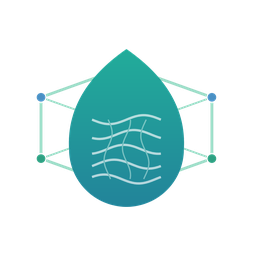
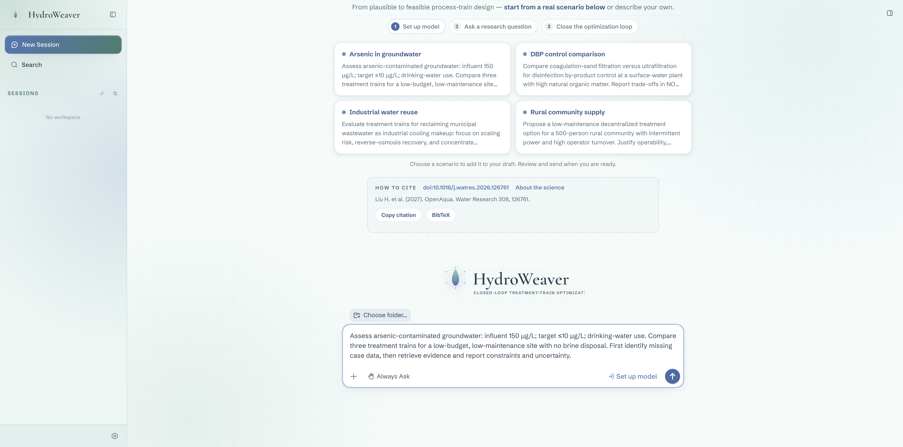
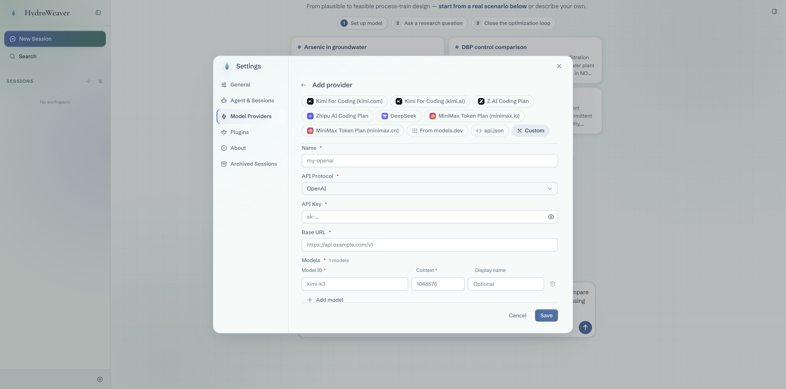
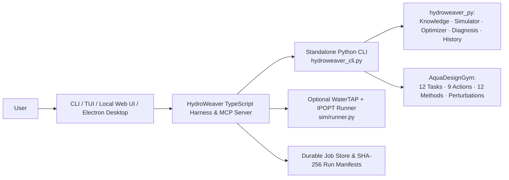

<p align="center">
  
</p>

<h1 align="center">HydroWeaver</h1>

<p align="center"><strong>From Plausible to Feasible Water Treatment Train Designs through Agentic Closed-Loop Optimization</strong></p>

<p align="center"><strong>Beta · v0.3.0-beta.1</strong></p>

<p align="center"><strong>English</strong> | <a href="./README.zh-CN.md">简体中文</a></p>

<p align="center">
  A standalone agentic workbench for jointly designing water-treatment train configurations and continuous operating conditions under water-quality, resource, and cost constraints — featuring a closed-loop harness, mechanistic &amp; LCOW process simulation, optional WaterTAP/IPOPT NLP solving, and the <strong>AquaDesignGym</strong> benchmark environment.
</p>

<p align="center">
  <a href="https://github.com/zhaorui-bi/HydroWeaver/actions/workflows/ci.yml"></a>
  <a href="https://github.com/zhaorui-bi/HydroWeaver/releases"></a>
  <a href="./LICENSE"></a>
  
  
</p>

---

## Why HydroWeaver?

One-shot AI treatment-train suggestions look **plausible**: they read smoothly
and match common textbook unit sequences, yet routinely fail once mass
balances, chemical dosing, membrane scaling/fouling, disinfection CT, brine
disposal limits, energy limits, or lifecycle cost constraints are evaluated
quantitatively.

**HydroWeaver** closes that gap natively in Python and TypeScript through an
agentic closed-loop architecture:

```text
  Knowledge-Informed Configuration Generation (17 units · 12 contaminants · 10 priors)
        │
        ▼
  Numerical Operating-Parameter Optimization (bounded coordinate + Hooke–Jeeves search)
        │
        ▼
  Mechanistic Process Simulation & LCOW Costing (quality, resources, CAPEX/OPEX, SEC)
        │
        ▼
  Simulation-Feedback Diagnosis ──► Feasible? ──► Record in SharedDesignHistory & Stop
        │
        ├── Parametric failure  ──► refine_parameters (adjust pressures, doses, flux, CT)
        └── Structural blocker  ──► revise_structure  (add / remove / replace / reorder units)
```

Everything executes out-of-the-box using Python’s standard library (zero
required third-party Python packages), with optional **WaterTAP / IDAES / Pyomo /
IPOPT** flowsheet simulation and NLP cost optimization when an environment such
as `HYDROWEAVER_SIM_PYTHON` is provided.

### Key Capabilities

| Capability | Details |
| --- | --- |
| **Joint Closed-Loop Optimization** | `hydroweaver_optimize_trains` (`hydroweaver optimize`) jointly searches discrete unit sequences and continuous operating conditions under a shared simulation oracle budget (`maxSimCalls`) while logging every round in `SharedDesignHistory`. |
| **Mechanistic & Cost Simulator** | Simulates steady-state mass balances, speciation/pre-oxidation, osmotic pressure & solution-diffusion rejection, scaling (`hardness * CF`), fouling, CT/DBP risk, chemical/electricity/sludge/brine OPEX, CAPEX, SEC, footprint, and LCOW across 17 treatment units. |
| **AquaDesignGym Benchmark** | Interactive environment (`hydroweaver gym tasks` / `hydroweaver gym eval`) with 12 standardized design tasks, 9 admissible structural/parametric actions, matched simulation budgets, 3 influent perturbation regimes (`nominal`, `mild_shift`, `severe_shift`), and 12 baselines & component ablations. |
| **Optional WaterTAP / IPOPT Flowsheet** | `hydroweaver_simulate_train` (`optimizeDesign=true`) builds real Pyomo/IDAES/WaterTAP flowsheets with `WaterTAPCosting` and optimizes LCOW via IPOPT. |
| **Gated Research & Provenance** | 26 MCP tools covering query normalization, case readiness assessment, local hybrid evidence retrieval, joint optimization, report auditing, AquaDesignGym evaluation, persistent multi-stage research tasks, and SHA-256 run manifests. |
| **Multi-Surface Workbench** | CLI, terminal UI (TUI), local Web UI, Electron desktop app, and MCP stdio server built on the MIT-licensed [Kimi Code](https://github.com/MoonshotAI/kimi-code) harness. |

> [!IMPORTANT]
> HydroWeaver supports early-stage process synthesis, screening, and algorithmic
> research benchmarking. "Feasible" indicates satisfaction of declared numerical
> and engineering constraints inside the simulator; it does not replace pilot
> testing, regulatory compliance review, or detailed site engineering design.

## Workbench Preview





## Architecture Overview



## Quick Start

### 1. Install and Build

Requirements: **Node.js ≥ 24.15**, **npm 12**, **Python ≥ 3.10**.

```bash
git clone https://github.com/zhaorui-bi/HydroWeaver.git
cd HydroWeaver

npm ci
npm run setup
```

### 2. Verify Standalone Backend

No external repositories or datasets are required:

```bash
./bin/hydroweaver doctor --probe
./bin/hydroweaver tools --json
```

Optionally configure an API model provider for conversational CLI/TUI/Web turns
or a WaterTAP Python interpreter (`--hydroweaver-python` / `HYDROWEAVER_SIM_PYTHON`):

```bash
./bin/hydroweaver onboard --provider deepseek --api-key-env DEEPSEEK_API_KEY --yes
```

### 3. Run Closed-Loop Optimization & AquaDesignGym

Optimize the bundled synthetic arsenic groundwater case:

```bash
./bin/hydroweaver optimize --input examples/cases/arsenic-groundwater.json --max-sim-calls 60 --wait
```

Inspect and evaluate AquaDesignGym (comparing HydroWeaver against conventional
optimizers, agent baselines, and component ablations under matched simulation
budgets and influent perturbations):

```bash
./bin/hydroweaver gym tasks
./bin/hydroweaver gym eval --max-sim-calls 60 --seed 42 --wait
```

Or launch interactive surfaces:

```bash
./bin/hydroweaver       # TUI
./bin/hydroweaver chat  # REPL
./bin/hydroweaver web   # Browser UI
npm start               # Electron Desktop
```

## Documentation

- [Quickstart](./docs/QUICKSTART.md)
- [Architecture](./docs/ARCHITECTURE.md)
- [Scientific Workflows & AquaDesignGym Protocol](./docs/SCIENTIFIC_WORKFLOWS.md)
- [WaterTAP Simulation & NLP Design](./docs/SIMULATION.md)
- [Durable Research Tasks & Provenance](./docs/RESEARCH_TASKS.md)
- [FAQ](./docs/FAQ.md) · [Troubleshooting](./docs/TROUBLESHOOTING.md) · [Release Guide](./docs/RELEASE.md)

## Citation

If you use HydroWeaver or AquaDesignGym in your research, cite [CITATION.cff](./CITATION.cff)
and report the HydroWeaver version, simulator mode, matched simulation budget,
and model configuration used.

## License

MIT — see [LICENSE](./LICENSE) and [licenses/THIRD_PARTY_NOTICES.md](./licenses/THIRD_PARTY_NOTICES.md).
