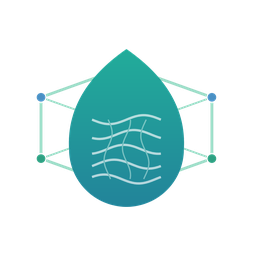

<p align="center">
  
</p>

<h1 align="center">HydroWeaver</h1>

<p align="center"><strong>从“看似合理”到“切实可行”：以智能体闭环优化驱动水处理工艺路线设计</strong></p>

<p align="center"><strong>Beta · v0.3.0-beta.1</strong></p>

<p align="center"><a href="./README.md">English</a> | <strong>简体中文</strong></p>

<p align="center">
  一个完全独立运行的水处理智能体工作台：在水质、资源与成本约束下联合优化工艺链结构与连续运行参数，内置闭环调度引擎、机理与全生命周期成本（LCOW）模拟器、可选 WaterTAP/IPOPT 流程优化，以及匹配模拟预算的交互式评测环境 <strong>AquaDesignGym</strong>。
</p>

<p align="center">
  <a href="https://github.com/zhaorui-bi/HydroWeaver/actions/workflows/ci.yml"></a>
  <a href="https://github.com/zhaorui-bi/HydroWeaver/releases"></a>
  <a href="./LICENSE"></a>
  
  
</p>

---

## HydroWeaver 是什么？

一次性生成的工艺建议往往只是**看似合理（plausible）**：文字看似完整，但在质量守恒、药剂投加、结垢与膜污染、消毒 CT 与副产物风险、浓水处置许可、能耗及单位制水成本（LCOW）等定量约束下往往不可行。

**HydroWeaver** 在内置独立科学引擎中通过闭环反馈实现**结构与参数的联合可行化设计**：

```text
  知识驱动的配置生成（17 类单元 · 12 类污染物 · 10 组先验模板）
        │
        ▼
  数值运行参数优化（有界坐标搜索 + Hooke–Jeeves 模式外推）
        │
        ▼
  稳态机理模拟与 LCOW 经济核算（出水水质、资源约束、CAPEX/OPEX、比能耗）
        │
        ▼
  仿真反馈违约诊断 ──► 全部约束满足？ ──► 记入共享设计历史（SharedDesignHistory）并收敛
        │
        ├── 参数性失配 ──► refine_parameters（联合微调压力、药剂、通量、CT）
        └── 结构性缺陷 ──► revise_structure （增/删/替换/重排工艺单元）
```

默认科学引擎与评测基准全部基于 Python 标准库实现（零外部仓库依赖、零额外 pip 依赖）；配置 `HYDROWEAVER_SIM_PYTHON` 后可进一步调用 **WaterTAP / IDAES / Pyomo / IPOPT** 执行严格流程模拟与 NLP 经济优化。

### 核心能力

| 能力 | 说明 |
| --- | --- |
| **结构–参数闭环联合优化** | `hydroweaver_optimize_trains`（`hydroweaver optimize`）在统一模拟预算 `maxSimCalls` 下联合搜索工艺单元序列与连续运行参数，逐轮记录诊断、决策与 `SharedDesignHistory`。 |
| **机理过程模拟与 LCOW 核算** | 覆盖预氧化与价态转化、渗透压与溶解–扩散截留、结垢指数（`hardness × CF`）、膜污染负荷、CT 消毒与 DBP 风险、药剂/电耗/污泥/浓盐水运行费用、设备投资与比能耗（SEC）。 |
| **AquaDesignGym 基准环境** | 通过 `hydroweaver gym tasks` / `hydroweaver gym eval` 提供 12 个标准化设计任务、9 类许可结构/参数动作、严格模拟次数预算控制、3 档进水扰动（`nominal` / `mild_shift` / `severe_shift`）及 12 个基线与消融对比方法。 |
| **可选 WaterTAP / IPOPT 求解** | `hydroweaver_simulate_train`（支持 `optimizeDesign=true`）构建真实 WaterTAP/IDAES 流程图与 `WaterTAPCosting`，由 IPOPT 求解最低 LCOW 设计点。 |
| **26 个 MCP 工具与运行溯源** | 涵盖查询归一化、案例完备性检查、本地混合检索、闭环优化、AquaDesignGym 评测、报告审计、八阶段持久化研究任务与防篡改 SHA-256 清单。 |
| **全端界面** | 提供 CLI、TUI、本地 Web UI、Electron 桌面端与 MCP stdio 服务器（基于 MIT 许可的 [Kimi Code](https://github.com/MoonshotAI/kimi-code) 引擎）。 |

## 快速开始

### 1. 安装与构建

需要 **Node.js ≥ 24.15**、**npm 12** 与 **Python ≥ 3.10**：

```bash
git clone https://github.com/zhaorui-bi/HydroWeaver.git
cd HydroWeaver

npm ci
npm run setup
```

### 2. 检查内置引擎

无需任何外部仓库或额外数据下载：

```bash
./bin/hydroweaver doctor --probe
./bin/hydroweaver tools --json
```

### 3. 运行闭环优化与 AquaDesignGym 评测

```bash
# 运行闭环优化示例
./bin/hydroweaver optimize --input examples/cases/arsenic-groundwater.json --max-sim-calls 60 --wait

# 查看与评测 AquaDesignGym 任务、基线与组件消融
./bin/hydroweaver gym tasks
./bin/hydroweaver gym eval --max-sim-calls 60 --seed 42 --wait
```

或启动交互式界面：

```bash
./bin/hydroweaver       # 终端 TUI
./bin/hydroweaver chat  # 命令行 REPL
./bin/hydroweaver web   # 浏览器界面
npm start               # Electron 桌面端
```

## 文档导航

- [快速上手](./docs/zh-CN/QUICKSTART.md) · [领域工作流](./docs/zh-CN/DOMAIN_WORKFLOW.md)
- [常见问题](./docs/zh-CN/FAQ.md) · [故障排查](./docs/zh-CN/TROUBLESHOOTING.md)
- [Architecture (EN)](./docs/ARCHITECTURE.md) · [Scientific Workflows (EN)](./docs/SCIENTIFIC_WORKFLOWS.md) · [WaterTAP Simulation (EN)](./docs/SIMULATION.md)

## 许可与引用

项目采用 MIT 许可，详见 [LICENSE](./LICENSE)、[CITATION.cff](./CITATION.cff) 与 [licenses/THIRD_PARTY_NOTICES.md](./licenses/THIRD_PARTY_NOTICES.md)。
