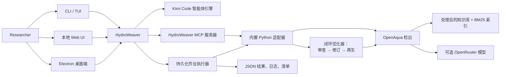

<p align="center">
  
</p>

<h1 align="center">HydroWeaver</h1>

<p align="center"><strong>从“看似合理”到“切实可行”：以智能体闭环优化驱动水处理工艺链设计</strong></p>

<p align="center"><strong>Beta 候选版 · v0.2.0-beta.1</strong></p>

<p align="center"><a href="./README.md">English</a> | <strong>简体中文</strong></p>

<p align="center">
  一个把早期水处理问题收敛为<strong>满足约束条件</strong>工艺链的本地工作台：它把开源 <a href="https://github.com/zhaorui-bi/OpenAqua">OpenAqua</a> 五智能体研究流水线包进“审查—修订—再生”的闭环，并提供 CLI、TUI、本地 Web、Electron 桌面端、MCP 工具、持久化任务与工程溯源。
</p>

<p align="center">
  <a href="https://github.com/zhaorui-bi/HydroWeaver/actions/workflows/ci.yml"></a>
  <a href="https://github.com/zhaorui-bi/HydroWeaver/releases"></a>
  <a href="./LICENSE"></a>
  
  
</p>

---

## HydroWeaver 是什么？

一次性的工艺链推荐只是**看似合理（plausible）**：读起来通顺、引用了证据，却可能违反
工程现场真正必须遵守的约束。HydroWeaver 就是为了弥合这道鸿沟。它保留 OpenAqua 的
类型化科学流水线——

```text
任务解析 → 证据检索 → 工艺规划 → 约束审查 → 解释输出
```

——并在其外包裹一个**智能体闭环**，反复迭代，直到交付的工艺链在声明的工程约束下
**切实可行（feasible）**：

```text
        ┌──────────────────────────────────────────────────────────┐
        │                                                          │
        ▼                                                          │
  生成候选工艺链 ──► 施加约束审查 ──► 所有链都通过？
  （规划智能体或调用方提供）  （分类体系、消毒、              │
                             浓盐水处置、能耗规则）            │
        ▲                                          可行 ──► 停止  │
        │                                                          │
  停滞时（审查无进展）──► 携带结构化修订指令                     │
  通过规划智能体再生候选链                                        │
```

每一轮都被完整记录：审查自动修订前后的候选链、机器可读的约束报告、未解决的违规
项，以及回送给规划智能体的修订指令。循环在以下三种情况之一明确停止：所有链通过
约束检查、审查与规划都不再产生进展、或轮次预算耗尽——记录中总会说明是哪一种。

HydroWeaver 内嵌 MIT 许可的 [Kimi Code](https://github.com/MoonshotAI/kimi-code)
智能体引擎，通过 MCP stdio 服务器暴露流水线与闭环，并在终端、浏览器和桌面端
提供同一产品。OpenAqua 本身仍是外部的 MIT 许可 Python 项目；本仓库不内置任何
Python 科学代码与知识数据。

### 核心能力

| 能力 | 说明 |
| --- | --- |
| **闭环优化** | `hydroweaver_optimize_trains` 以有界轮次预算执行“审查 → 修订 → 再生”循环，逐轮输出约束报告、结构化规划修订指令与明确的收敛状态（`feasible` / `stalled` / `budget_exhausted`）。 |
| **五智能体科学流水线** | 通过 OpenAqua 后端完成查询归一化、混合证据检索、分类体系约束下的规划、规则审查与证据绑定解释。 |
| **26 个 MCP 工具** | 覆盖分阶段研究任务、运行状态、科学案例完备性评估、闭环优化、机理流程模拟、推荐报告审计、分类目录、推荐、检索、约束检查、索引、知识暂存、WContBench 评测与作业管理。 |
| **持久化研究任务** | 保存案例修订、声明范围、结构化待补信息、作业与轮次预算，支持“就绪 → 评估 → 检索 → 推荐 → 优化 → 审计 → 交付”七阶段的跨会话恢复。 |
| **多种界面** | 完整 TUI、一次性 CLI、轻量 REPL、本地 Web UI 和 Electron 桌面端。 |
| **持久化工程任务** | 长任务在会话退出后仍可恢复，并记录状态、日志、输出、输入哈希、JSON 载荷哈希与请求指纹。 |
| **双模型层** | HydroWeaver 对话智能体使用 API 提供方；OpenAqua 后端可选使用 `OPENROUTER_API_KEY`。 |
| **本地优先安全设计** | 私有配置、原子写入、严格路径处理、无 shell 拼接、有界输出与默认回环地址 Web 服务。 |

> [!IMPORTANT]
> HydroWeaver 的输出属于早期工程决策支持。“可行（feasible）”仅表示所有工艺链
> 通过了机器可读的约束检查，不代表完成选型、造价核算或现场验证。它不是最终
> 工艺设计、法规合规证明或性能保证。实施前必须经过专业人员审核、适用法规审查、
> 可处理性试验、中试及场地化工程设计。

## 界面概览

以下为本地 Web UI 的真实截图，桌面端共用同一界面。


**研究工作台。** 左侧按工作区组织会话，中央通过对话开展研究任务。


**模型配置。** 打开 **Settings → Model Providers → Add provider → Custom**
选择 API 协议、服务地址（**Base URL**）与可用模型。密钥字段为空，仅显示占位符。
这些设置控制 HydroWeaver 的对话模型；OpenAqua 的可选后端模型单独配置。

## 系统架构



OpenAqua 源码与 Hugging Face 数据**不内置**于本仓库。内置适配器在外部
OpenAqua 检出之上提供稳定的命令契约，其中 `optimize` 命令在单个有界后端
进程内驱动整个闭环。

## 环境要求

- Node.js **24.15.0 或更高**
- npm **12**
- 用于 OpenAqua 后端的 Python **3.10 或更高**
- 一份本地 OpenAqua 检出
- 处理后的 OpenAqua 数据与已构建索引（分类目录/检索/设计）
- macOS、Linux 或 Windows

## 快速开始

### 1. 安装 HydroWeaver

```bash
git clone https://github.com/zhaorui-bi/HydroWeaver.git
cd HydroWeaver

npm ci
npm run setup
```

`npm run setup` 会安装锁定的引擎工作区、构建 HydroWeaver 并同步品牌化 Web UI。

### 2. 安装 OpenAqua

```bash
git clone https://github.com/zhaorui-bi/OpenAqua.git
cd OpenAqua
git checkout 0e3990817946f1786828fabbfa9ba4bc06af96e8
cd water_treatment_agent

python3 -m venv .venv
source .venv/bin/activate                 # Windows: .venv\Scripts\activate
python -m pip install -r requirements.txt
```

从 [Hugging Face](https://huggingface.co/datasets/zhaorui-bi/OpenAqua)
下载处理后的知识库与 WContBench：

```bash
python -m pip install -U huggingface_hub
hf download zhaorui-bi/OpenAqua data.zip WContBench/ \
  --repo-type dataset \
  --revision cc2d3c620e8ada7c62fa922cf3a827d8b42889e3 \
  --local-dir ../hf_openaqua

unzip ../hf_openaqua/data.zip -d .
```

压缩包已包含顶层 `data/` 目录，请解压到 `water_treatment_agent`，而不是解压到
已有的 `data/` 目录中。上述 Git 与 Hugging Face 修订是 `0.1.0-beta.1` 的验证基线，
`0.2.0-beta.1` 继续沿用；如需更新请记录并重新验证。保留
`../hf_openaqua/WContBench/` 用于评测。`RawData.zip` 可选。

### 3. 配置双模型层

HydroWeaver 智能体需要一个对话模型提供方。OpenAqua 本身可选使用 OpenRouter；
未配置时使用其规则/模板回退。

```bash
# 可选的 OpenAqua 后端 LLM
export OPENROUTER_API_KEY="..."
export HYDROWEAVER_OPENROUTER_MODEL="anthropic/claude-3.5-sonnet"  # 可选共享覆盖
# 更细粒度：HYDROWEAVER_DEFAULT_MODEL、
# HYDROWEAVER_PLANNER_MODEL 与 HYDROWEAVER_EXPLANATION_MODEL。

# HydroWeaver 智能体模型（示例：DeepSeek）
export DEEPSEEK_API_KEY="..."
cd /path/to/HydroWeaver
./bin/hydroweaver onboard \
  --provider deepseek \
  --api-key-env DEEPSEEK_API_KEY \
  --hydroweaver-repo /path/to/OpenAqua
```

也支持交互式配置：

```bash
./bin/hydroweaver onboard
```

### 4. 构建索引并验证

```bash
./bin/hydroweaver doctor --probe
./bin/hydroweaver tools
```

然后让智能体执行 `hydroweaver_build_indexes`，或直接运行适配器：

```bash
HYDROWEAVER_REPO=/path/to/OpenAqua \
  ./bin/hydroweaver run "检查 OpenAqua 状态，并在缺少索引时构建知识索引。"
```

### 5. 启动界面

```bash
./bin/hydroweaver                                       # 完整 TUI
./bin/hydroweaver run "为含砷地下水推荐处理工艺链"
./bin/hydroweaver chat                                  # 轻量 REPL
./bin/hydroweaver web                                   # 本地浏览器 UI
npm start                                               # Electron 桌面端
```

Windows 上请使用 `npm run cli -- <command>` 代替 `./bin/hydroweaver`。

## 闭环：从看似合理到切实可行

闭环优化器是“读起来合理的候选清单”和“能通过场地自身规则筛选的候选清单”之间的
差别。直接运行：

```bash
./bin/hydroweaver optimize --input case.json --top-k 3 --max-rounds 4 --wait
```

或让智能体调用 `hydroweaver_optimize_trains`。返回的记录完整展示工艺链的演化：

```json
{
  "kind": "hydroweaver.closed-loop-optimization",
  "optimization": {
    "status": "feasible",
    "rounds_used": 2,
    "max_rounds": 4,
    "initial_source": "caller",
    "planner_regeneration_used": false,
    "feasible_chains": 1,
    "unresolved": []
  },
  "rounds": [
    {
      "round": 1,
      "source": "caller",
      "candidates_before": [["Membrane Separation"]],
      "constraint_report": { "chain_reports": [{ "chain_id": "chain-1", "overall_status": "FAIL" }] },
      "metrics": { "feasible": false, "unresolved_count": 1 }
    },
    {
      "round": 2,
      "source": "critic-revision",
      "revision_directive": null,
      "candidates_after_revision": { "candidates": [{ "chain_id": "chain-1", "chain": ["Adsorption", "Disinfection"] }] },
      "constraint_report": { "chain_reports": [{ "chain_id": "chain-1", "overall_status": "PASS" }] },
      "metrics": { "feasible": true, "unresolved_count": 0 }
    }
  ],
  "final_trains": [
    { "chain_id": "chain-1", "chain": ["Adsorption", "Disinfection"], "constraint_report": { "overall_status": "PASS" } }
  ]
}
```

循环语义：

- **初始候选链**来自规划智能体（`--top-k` 条）或调用方通过 `candidateChains` 提供。
- **每一轮**施加约束审查，并记录每条链的状态、违规项与审查器的就地自动修订。
- **停滞回退**：当某轮审查毫无进展时，循环携带指明失败工艺链及其违规项的结构化
  修订指令，通过规划智能体再生候选链。
- **停止条件**是显式的：`feasible`（全部通过）、`stalled`（审查与规划均无进展）
  或 `budget_exhausted`（轮次预算用尽）。
- 缺少机器可读约束报告的工艺链永远不会被判为可行。

## 示例提问

结构化的提示能给流水线最清晰的契约：

```text
请使用 HydroWeaver 评估砷浓度 150 µg/L 的地下水。
目标为 WHO 指南 ≤10 µg/L。预算紧张、操作人员技能有限、无浓盐水处置条件，
水源用于饮用。归一化查询、检索证据、推荐三条处理工艺链，
对它们做闭环优化直到每条链都通过约束检查，展示修订轮次与不确定性，
并保存 JSON 结果。
```

智能体应当保留单位、检查分类体系就绪状态、启动持久化推荐作业，随后启动有界
优化作业，并返回作业/输出标识而不是编造性能数值。

遵循“案例到报告”的工作流：**评估并澄清案例 → 审查证据适用性 → 比较工艺链 →
闭合优化循环 → 审计并交付**。在推荐前调用 `hydroweaver_assess_case`，
用 `hydroweaver_optimize_trains` 精炼推荐工艺链，对保存的结果调用
`hydroweaver_audit_report`；作业成功与科学审计状态是两回事。未能在预算内达到
可行的优化循环会产生明确的待办事项——绝不会悄悄降级为“可行”结论。进水与出水
硝酸盐报告基准（以 NO₃ 或 N 计）需分别声明，铅端点、砷形态与设计流量通过兼容的
`extra` 字段保留。参见
[领域工作流与合成案例（简体中文）](./docs/zh-CN/DOMAIN_WORKFLOW.md)。

## 持久化案例到报告研究

使用六个 `hydroweaver_research_*` 工具或 `hydroweaver research` 命令发起完整的
案例到报告请求。任务会冻结案例、把每个阶段关联到持久化作业，并以结构化待办
事项返回缺失信息。`advance` 会先核对既有作业再推进；关键案例缺口、未决的优化
循环以及报告审计的警告/失败都会阻止就绪交付。默认预算为六个后端作业（评估、
检索、推荐、优化、审计，外加一次重试余量），最大 16；优化阶段另有有界轮次预算
（默认 3，最大 8）。

任务控制无需打开对话模型会话即可返回 JSON；后端执行使用配置好的 OpenAqua
运行时与可选模型。最初的 18 个工具仍可用于单个操作。这些门禁仅作用于研究
任务，调用方声明的响应不构成已验证的人工审批。参见
[可运行工作流、CLI 契约与设计参考](./docs/RESEARCH_TASKS.md)。

## CLI 参考

| 命令 | 用途 |
| --- | --- |
| `hydroweaver` | 启动品牌化交互式 TUI。 |
| `hydroweaver run "<prompt>"` | 执行一次智能体任务并流式输出。 |
| `hydroweaver chat` | 启动轻量持久化 REPL。 |
| `hydroweaver optimize [options]` | 直接运行闭环优化：`[--input FILE] [--top-k N] [--max-rounds N] [--wait] [--home DIR]`。 |
| `hydroweaver web [options]` | 启动带认证的本地 Web UI。 |
| `hydroweaver onboard [options]` | 配置主目录、模型提供方、后端、MCP 与技能。 |
| `hydroweaver doctor [--json] [--probe]` | 校验运行时、存储、模型、资产、MCP、技能与 OpenAqua 健康状态。 |
| `hydroweaver tools [--json]` | 列出工具、参数、后端解析与安全注解。 |
| `hydroweaver research <action> [--input FILE]` | 创建、查看、列出、推进、响应或取消持久化研究任务；status/advance 也接受 `--id ID`。 |
| `hydroweaver info` | 输出版本号与解析后的运行时路径。 |

常用的 onboard 参数包括 `--hydroweaver-repo DIR`、
`--hydroweaver-command COMMAND`、`--provider`、`--api-key-env`、`--model` 与
`--base-url`。运行 `hydroweaver --help` 查看严格语法。

## MCP 工具

| 工具 | 用途 |
| --- | --- |
| `hydroweaver_status` | 检查 Python、依赖、OpenAqua 修订、知识资产、索引与 OpenRouter 状态。 |
| `hydroweaver_catalog` | 检索规范污染物与处理单元名称。 |
| `hydroweaver_normalize_query` | 仅执行解析与分类体系归一化。 |
| `hydroweaver_assess_case` | 构建结构化案例状态，并在推荐前排序关键缺失信息。 |
| `hydroweaver_recommend` | 执行 解析 → 检索 → 规划 → 审查 → 解释 全流程。 |
| `hydroweaver_optimize_trains` | 执行闭环优化：审查、保留自动修订、停滞时携带修订指令经规划智能体再生，并在可行、停滞或轮次预算耗尽时停止；返回逐轮约束报告与可行工艺链。 |
| `hydroweaver_retrieve_evidence` | 返回归一化查询与单元/案例检索证据。 |
| `hydroweaver_check_constraints` | 对候选工艺链施加分类体系、消毒、浓盐水与能耗规则。 |
| `hydroweaver_build_indexes` | 重建 `corpus.jsonl` 与 BM25 索引。 |
| `hydroweaver_ingest_knowledge` | 暂存 `kb_unit`/`kb_case` 记录并可选重建索引。 |
| `hydroweaver_evaluate_trains` | 运行 WContBench 工艺链指标。 |
| `hydroweaver_evaluate_retrieval` | 在指定 k 上运行 WContBench 检索指标。 |
| `hydroweaver_audit_report` | 构建结构化“论断—证据”台账，标记支持缺失、约束失败与选定的定量论断风险。 |
| `hydroweaver_job_list` | 恢复最近的持久化作业。 |
| `hydroweaver_job_status` | 读取生命周期、计时与输出状态。 |
| `hydroweaver_job_manifest` | 检查工程溯源与有界输出清单。 |
| `hydroweaver_job_log` | 以游标分页读取有界的原始/错误/事件日志摘录。 |
| `hydroweaver_job_artifacts` | 列出输出元数据（不跟随符号链接）。 |
| `hydroweaver_job_cancel` | 以有界的优雅升级取消进程树。 |
| `hydroweaver_research_create` | 把案例与声明目标冻结为幂等的研究请求。 |
| `hydroweaver_research_status` | 读取持久化状态、待办事项、任务分派与下一步动作。 |
| `hydroweaver_research_list` | 在不推进的前提下恢复最近的研究任务。 |
| `hydroweaver_research_advance` | 核对当前作业并在预算内推进科学门禁。 |
| `hydroweaver_research_respond` | 记录经版本校验的、调用方声明的修订、条件筛查决定或合规重试。 |
| `hydroweaver_research_cancel` | 取消任务及其活动作业，同时保留历史。 |

## 后端解析

工作台按以下顺序解析适配器兼容的后端：

1. `HYDROWEAVER_COMMAND`；
2. `~/.hydroweaver/hydroweaver.json`（`command` 或 `repo`）；
3. `HYDROWEAVER_REPO`；
4. `PATH` 上适配器兼容的 `hydroweaver` 可执行文件。

对于仓库检出，按以下顺序定位 Python：

1. `HYDROWEAVER_PYTHON`；
2. 仓库根目录的 `.venv`/`venv`；
3. `water_treatment_agent/` 下的 `.venv`/`venv`；
4. `python3`、`python` 或 Windows 的 `py -3` 启动器。

示例：

```bash
export HYDROWEAVER_REPO=/absolute/path/to/OpenAqua
export HYDROWEAVER_PYTHON=/absolute/path/to/OpenAqua/water_treatment_agent/.venv/bin/python
./bin/hydroweaver doctor --probe
```

## 持久化作业与溯源

推荐、闭环优化、检索、索引构建、知识暂存与评测都在发起 MCP 请求之外运行。
每个作业拥有独立目录：

```text
<workdir>/hydroweaver-jobs/<jobId>/
├── job.json
├── run.log
├── completion.json
├── exit.code
└── run-manifest.json
```

工程清单记录已验证的请求参数、后端命令与适配器报告的版本/修订、运行时身份、
非涉密模型/检索/规划设置、常规文件 SHA-256 哈希、有界递归的基准目录指纹、
内联 JSON 载荷哈希、配置的输出路径以及稳定的 `requestSha256`。API 密钥从不
被记录。作业结束时，同一清单会单独记录配置输出文件或目录的经验证指纹。在声称
可复现的比较之前，请同时保留 OpenAqua 提交、Hugging Face 快照、生成的索引、
模型设置与后端结果 JSON。

## 已知边界

- 工作台不内置 OpenAqua Python 依赖与 Hugging Face 数据。
- 闭环通过上游审查器优化“已声明约束下的可行性”，不建立处理性能、目标达成、
  安全性或法规合规。
- 未配置 `OPENROUTER_API_KEY` 时自然语言抽取能力较弱；测量数据建议使用显式
  结构化字段。
- `hydroweaver_ingest_knowledge` 沿用 OpenAqua v1 的暂存行为；上游索引构建器
  不会把暂存记录合并进规范知识文件。
- OpenAqua 的排序分综合了覆盖度、约束、证据与风险项，不是处理成功的校准概率。
- WContBench 衡量的是与基准参考的一致程度，不是法规或现场性能。

## 开发与质量

```bash
npm run check          # lint、类型检查、测试、TUI 检查、MCP/Web 冒烟、许可证与仓库不变量
npm run build          # 工作台、品牌化 Web UI 与上游 TUI
npm run pack           # 未打包的 Electron 应用
npm run smoke:desktop  # 打包后的桌面端启动冒烟
npm run release:check  # 发布门禁与依赖审计
```

生成的目录（`engine/apps/hydroweaver/dist/` 与 `web-ui/`）已被忽略。请修改
源码、主题或同步脚本。

## 文档

- [快速开始](./docs/zh-CN/QUICKSTART.md)
- [系统架构](./docs/ARCHITECTURE.md)
- [工程化工作流纪律](./docs/SCIENTIFIC_WORKFLOWS.md)
- [研究任务与优化阶段](./docs/RESEARCH_TASKS.md)
- [流程模拟集成（WaterTAP/IDAES/IPOPT）](./docs/SIMULATION.md)
- [常见问题](./docs/zh-CN/FAQ.md)
- [故障排查](./docs/zh-CN/TROUBLESHOOTING.md)
- [发布流程](./docs/RELEASE.md)
- [English README](./README.md)

## 致谢与引用

HydroWeaver 产品层代码采用 MIT 许可。内置引擎基于 MIT 许可的 Kimi Code 并
保留其上游许可。科学流水线、知识库与 WContBench 来自外部 MIT 许可的 OpenAqua
项目（作者：Hanzhang Liu、Zhaorui Jiang、Huiling Zhong、Jinshuo Li、Wei Pang、
Yingfang Yuan）。如果使用该科学工作流，请引用 OpenAqua 论文并注明所使用的
确切软件/数据版本：

> Liu H., Jiang Z., Zhong H., Li J., Pang W., Yuan Y. OpenAqua: an automated
> multi-agent framework for early-stage water treatment train design with
> retrieval augmentation and critic-based refinement. *Water Research* 308
> (2027) 126761. <https://doi.org/10.1016/j.watres.2026.126761>

OpenAqua 数据集（含 WContBench）位于
[huggingface.co/datasets/zhaorui-bi/OpenAqua](https://huggingface.co/datasets/zhaorui-bi/OpenAqua)。
关于框架、知识库与评测证据的通俗介绍见 [docs/zh-CN/OPENAQUA.md](./docs/zh-CN/OPENAQUA.md)。

根目录 [LICENSE](./LICENSE) 是 HydroWeaver 的 MIT 许可证。上游版权声明与依赖
记录保存在 [licenses/](./licenses/)。参见 [CITATION.cff](./CITATION.cff)、
[THIRD_PARTY_NOTICES.md](./licenses/THIRD_PARTY_NOTICES.md) 与
[SBOM.spdx.json](./licenses/SBOM.spdx.json)。

HydroWeaver 是独立产品，不得宣称为 OpenAqua 或 Kimi Code 的官方客户端。
